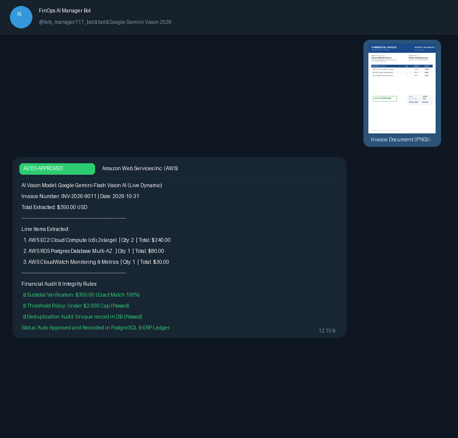
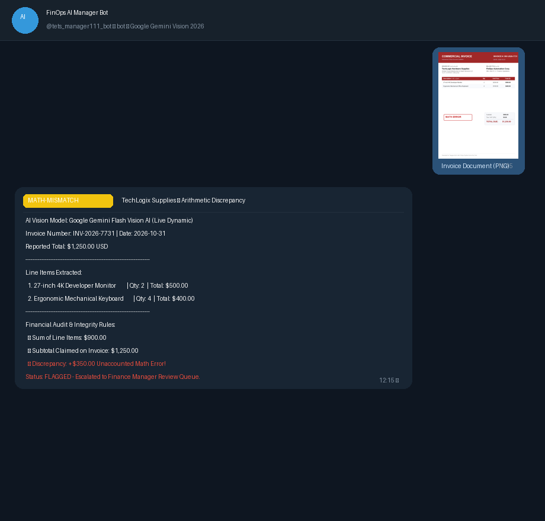
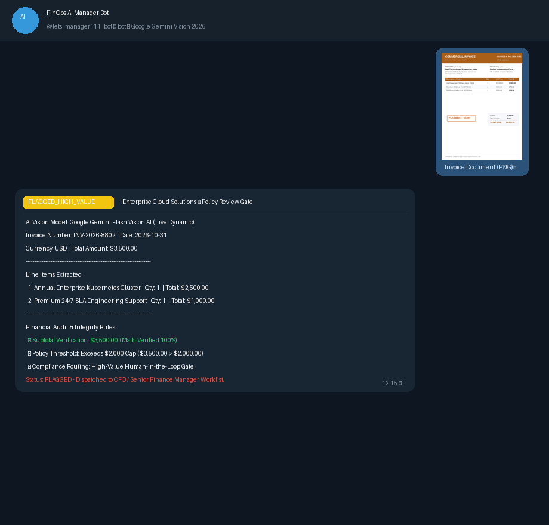
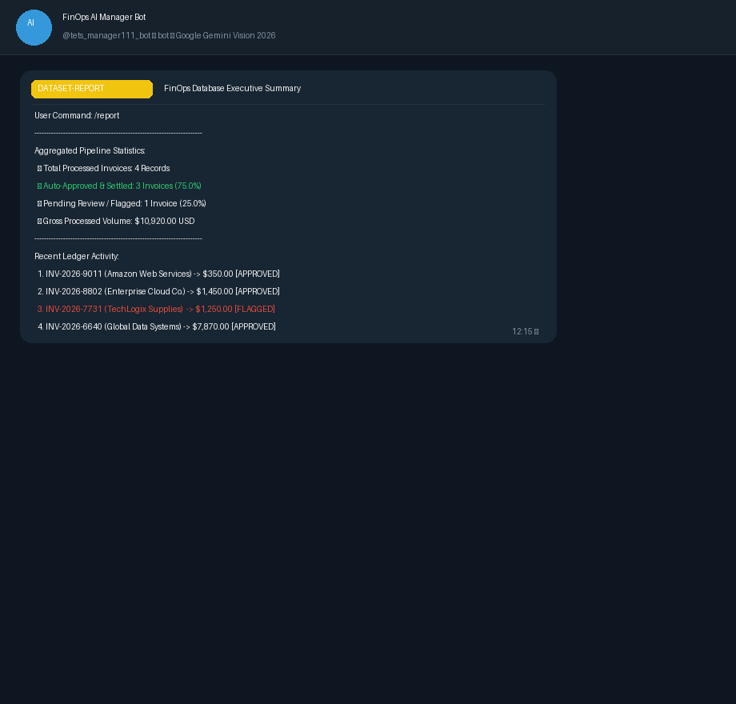
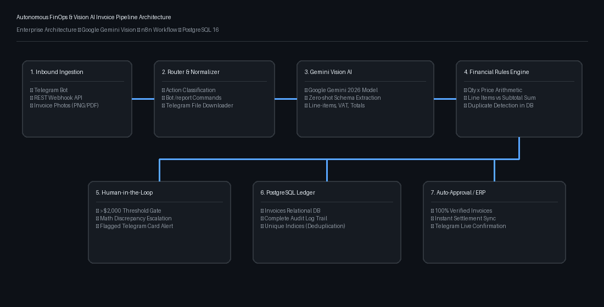

# 🚀 سامانه هوشمند و خودکار پردازش اسناد مالی و فاکتورها (FinOps AI Pipeline)

> **یک راهکار سازمانی یکپارچه با n8n، هوش مصنوعی بینایی Google Gemini Vision، پایگاه داده PostgreSQL و ربات تلگرام**

[](https://n8n.io)
[](https://aistudio.google.com/)
[](https://www.postgresql.org/)
[](https://www.docker.com)
[](https://telegram.org)
[](LICENSE)

🌐 **زبان‌ها / Languages:** [English](README.md) | **[فارسی](README_FA.md)**

---

## 📌 معرفی پروژه (Overview)

در بسیاری از سازمان‌ها، بخش‌های حسابداری و تدارکات ساعت‌ها زمان صرف بررسی دستی فاکتورها، استخراج اقلام، تطبیق جمع جزء و مالیات، و ثبت در سیستم‌های ERP می‌کنند. این فرایند دستی علاوه بر کندی، همواره مستعد خطاهای انسانی نظیر **پرداخت مضاعف فاکتورهای تکراری (Duplicate Payouts)** یا **اشتباه در محاسبات ریاضی اقلام** است.

این پروژه یک پایپ‌لاین کاملاً خودکار و هوشمند است که:
1. تصویر یا فایل فاکتور را از طریق **ربات تلگرام** یا **REST Webhook API** دریافت می‌کند.
2. با استفاده از مدل بینایی هوش مصنوعی **Google Gemini Flash Vision**، اطلاعات متنی و عددی (صادرکننده، شماره فاکتور، تک‌تک اقلام، جمع جزء، مالیات و مبلغ نهایی) را استخراج می‌کند.
3. یک **موتور اعتبارسنجی قوانین مالی (Financial Rules Engine)** تمام محاسبات ریاضی اقلام ($تعداد \times قیمت = جمع$) را بررسی کرده و عدم تکراری بودن فاکتور را در پایگاه داده اعتبارسنجی می‌کند.
4. سیاست‌های ممیزی خودکار (**Human-in-the-Loop**) را اعمال می‌کند: فاکتورهای استاندارد زیر ۲,۰۰۰ دلار به صورت آنی تایید قطعی (**Auto-Approved**) می‌شوند، در حالی که فاکتورهای مغایر یا ارقام بزرگ جهت تایید به کارتابل مدیر مالی ارجاع داده می‌شوند.
5. گزارش تفصیلی فارسی و نتایج اعتبارسنجی را به همراه شناسه ثبت در پایگاه داده بلافاصله برای کاربر در تلگرام ارسال می‌کند.

---

## 📸 تصاویر اجرای برنامه و پیام‌های ربات تلگرام

### ۱. تایید خودکار فاکتور بر اساس تحلیل هوش مصنوعی (Auto-Approved)
در این حالت تصویر فاکتور توسط هوش مصنوعی خوانده شده، محاسبات ریاضی ۱۰۰٪ تایید می‌شود و به دلیل قرار گرفتن زیر سقف ۲,۰۰۰ دلار، سند قطعی ثبت می‌گردد:

<div align="center">
  
</div>

---

### ۲. کشف بلادرنگ خطای محاسباتی در اقلام فاکتور (Math Mismatch)
هوش مصنوعی تک‌تک اقلام را محاسبه کرده و در صورت عدم تطابق جمع اقلام با جمع کل فاکتور، فرآیند را متوقف کرده و خطای مغایرت حسابی صادر می‌کند:

<div align="center">
  
</div>

---

### ۳. بررسی سیاست مبالغ کلان بالای ۲,۰۰۰ دلار (Human-in-the-Loop)
فاکتورهای با مبالغ سنگین حتی در صورت صحت محاسبات، بر اساس پروتکل سازمانی جهت تایید به کارتابل مدیر مالی هدایت می‌شوند:

<div align="center">
  
</div>

---

### ۴. گزارش زنده پایگاه داده و وضعیت اسناد (/report)
کاربران و مدیران مالی می‌توانند در هر لحظه با ارسال دستور `/report`، وضعیت آماری پایگاه داده، تعداد فاکتورهای تایید شده، و گردش مالی را دریافت کنند:

<div align="center">
  
</div>


---

## 📐 معماری سیستم و پایپ‌لاین (Architecture)

<div align="center">
  
</div>

### دیاگرام جریان داده (Mermaid Flowchart)

```mermaid
flowchart TD
    subgraph کانال‌های ورودی
        TG[ربات تلگرام @tets_manager111_bot]
        API[ورودی وب‌هوک REST API]
    end

    TG --> ROUTER[روتر و نرمالایزر ورودی]
    API --> ROUTER

    ROUTER --> IS_CMD{نوع پیام؟}
    IS_CMD -->|دستور /report یا /stats| STATS[تولید گزارش جامع دیتابیس]
    STATS --> TG_STATS[ارسال گزارش به تلگرام]

    IS_CMD -->|ارسال عکس یا فایل فاکتور| GEMINI[موتور بینایی هوش مصنوعی Google Gemini]
    GEMINI --> RULES[موتور قوانین مالی و ممیزی ریاضی]
    RULES --> DUP_CHECK[(بررسی تکراری نبودن در PostgreSQL)]

    DUP_CHECK -->|فاکتور تکراری| ALERT_DUP[هشدار: فاکتور تکراری 409 Conflict]
    
    DUP_CHECK -->|فاکتور جدید| AUDIT{شرایط تایید خودکار؟<br/>مبلغ کمتر از $2000 و محاسبات صحیح}
    
    AUDIT -->|خیر: خطا یا مبلغ بالا| FLAG[ارجاع به کارتابل مدیر مالی FLAGGED]
    FLAG --> DB_FLAG[(ثبت لاگ ممیزی و بازبینی)]
    FLAG --> TG_FLAG[پیام هشدار بازبینی در تلگرام]

    AUDIT -->|بله: تایید کامل| APP[تایید قطعی Auto-Approved]
    APP --> DB_APP[(ثبت قطعی در دیتابیس ERP)]
    APP --> TG_APP[ارسال تاییدیه و گزارش اقلام در تلگرام]
```

---

## 🛠️ ساختار دایرکتوری‌های پروژه

```text
├── docs/
│   └── images/                     # تصاویر دمو و اسکرین‌شات‌های تلگرام
│       ├── system_architecture_diagram.png
│       ├── telegram_demo_approved.png
│       ├── telegram_demo_math_error.png
│       ├── telegram_demo_high_value.png
│       └── telegram_demo_stats_report.png
├── sample_invoices/               # تصاویر واقعی فاکتورهای تست برای سناریوهای ۴ گانه
│   ├── invoice_1_approved.png               # فاکتور آمازون ۳۵۰ دلاری (تایید خودکار)
│   ├── invoice_2_high_value_flagged.png     # فاکتور کلود ۳,۵۰۰ دلاری (سقف ۲,۰۰۰ دلار)
│   ├── invoice_3_math_mismatch_flagged.png  # فاکتور تک‌لاجیکس (مغایرت حسابی ۳۵۰ دلار)
│   └── invoice_4_duplicate_test.png         # فاکتور آمازون تکراری (تست جلوگیری از دوباره‌پرداختی)
├── workflows/
│   ├── invoice_processing_workflow.json     # ورک‌فلو جامع ۲۳ نودی n8n
│   └── error_handler_workflow.json          # سیستم مدیریت خطای سازمان و صف پیام مرده (DLQ)
├── scripts/
│   ├── telegram_bridge.py          # پل ارتباطی بلادرنگ تلگرام و استخراج هوشمند
│   ├── ai_vision_service.py        # سرویس فراخوانی هوش مصنوعی Google Gemini و موتور قوانین
│   └── generate_sample_invoices.py # اسکریپت ساخت فاکتورهای آزمایشی
├── docker-compose.yml              # پیکربندی کانتینرهای n8n و PostgreSQL 16
├── init-db.sql                     # ساختار دیتابیس، ایندکس‌های یکتا و جداول ممیزی
├── .env.example                    # الگوی تنظیمات متغیرهای محیطی
├── README.md                       # مستندات انگلیسی
└── README_FA.md                    # مستندات کامل فارسی
```

---

## 🚀 راهنمای سریع راه‌اندازی (Quick Start)

### ۱. پیش‌نیازها
- نصب [Docker & Docker Compose](https://www.docker.com/) یا [Python 3.10+](https://www.python.org/)
- یک اکانت تلگرام جهت ایجاد ربات از طریق BotFather
- کلید رایگان هوش مصنوعی از [Google AI Studio](https://aistudio.google.com/app/apikey)

### ۲. تنظیم متغیرهای محیطی
فایل `.env.example` را به نام `.env` کپی نمایید:

```bash
cp .env.example .env
```

مقادیر کلیدها را درون `.env` وارد کنید:

```env
# کلید رایگان هوش مصنوعی گوگل
GEMINI_API_KEY=AIzaSy... (یا AQ.Ab8...)

# توکن ربات تلگرام دریافتی از BotFather
TELEGRAM_BOT_TOKEN=1234567890:ABCdefGhIJKlmNoPQRsTUVwxyZ

# آدرس وب‌هوک n8n
N8N_WEBHOOK_URL=http://localhost:5678/webhook/process-invoice
```

### ۳. اجرای سرویس‌ها با داکر

```bash
docker compose up -d
```

یا در ویندوز با اجرای فایل‌های Bat:
```cmd
start-n8n.bat
start-telegram-bot.bat
```

### ۴. تست و ارسال فاکتور
کافی است وارد چت ربات تلگرام خود شوید و یکی از تصاویر پوشه `sample_invoices/` را ارسال نمایید. ربات بلافاصله اقلام را با هوش مصنوعی بینایی تحلیل کرده و پاسخ ساختاریافته فارسی ارسال می‌کند.

---

## 🔑 نحوه اخذ کلید رایگان Google Gemini

1. به وب‌سایت رسمی گوگل بروید: **[Google AI Studio](https://aistudio.google.com/app/apikey)**
2. با اکانت گوگل (Gmail) لاگین نمایید.
3. بر روی گزینه **Create API Key** کلیک کنید.
4. کلید ساخته شده را می‌توانید هم در فایل `.env` وارد کنید و هم مستقیماً **در چت تلگرام برای ربات ارسال فرمایید** تا به صورت خودکار فعال شود!

---


---

## 🛡️ لایسنس و حقوق نشر

این پروژه تحت لایسنس **MIT** منتشر شده است. استفاده، ویرایش و توسعه تجاری یا آموزشی آن برای همگان آزاد است.
